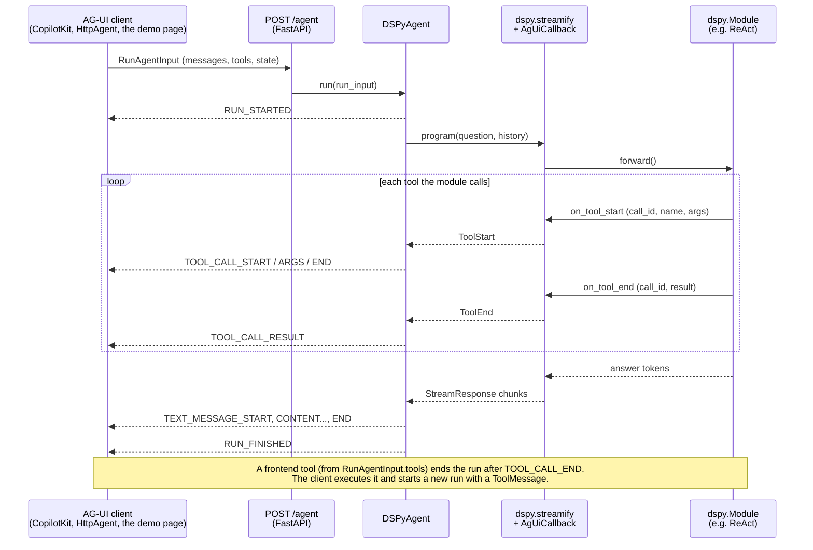

# ag-ui-dspy

[AG-UI](https://docs.ag-ui.com) integration for [DSPy](https://dspy.ai): expose any `dspy.Module` as an AG-UI agent, so CopilotKit and every other AG-UI client can drive it.

A community integration, maintained here and not by the AG-UI or DSPy teams. It follows the same package shape as the integrations in the AG-UI repo (`ag_ui_<framework>`, a `<Framework>Agent`, an `add_<framework>_fastapi_endpoint` helper) so it feels familiar next to them.

Backend tool calls, streamed answer text, conversation history and frontend (client-executed) tools all map onto the protocol with no changes to DSPy. The bridge uses two hooks DSPy already has: `dspy.streamify` and `BaseCallback`.




## Install

```bash
pip install ag-ui-dspy        # or: uv add ag-ui-dspy
```

## Run the demo

```bash
git clone https://github.com/wrabit/ag-ui-dspy && cd ag-ui-dspy
uv sync --all-groups
cp .env.example .env          # pick a model: any LiteLLM string, local or hosted
set -a; source .env; set +a
uv run uvicorn examples.server:app --port 8040
```

Open http://localhost:8040. The left pane is a chat, the right pane shows every AG-UI event as it arrives. Try:

- "weather in Kraków?" (backend tool)
- "what is 12 * (3 + 4)?" (backend tool)
- "help me pick a city for a weekend" (the agent calls the frontend tool `pick_option`; the page renders buttons; your click goes back as a `ToolMessage` in the next run)

To prove it is the protocol as published and not just our page, drive the same server with the official TypeScript client:

```bash
cd examples/node-client && npm install && npm start -- "weather in Tokyo?"
```

From CopilotKit or any other AG-UI client, point an `HttpAgent` at the endpoint URL. No client-side package from this repo is needed.

## Use it on your own module

```python
import dspy
from fastapi import FastAPI
from ag_ui_dspy import DSPyAgent, add_dspy_fastapi_endpoint

def make_agent(frontend_tools: list[dspy.Tool]) -> dspy.Module:
    # frontend_tools are the client's tools from RunAgentInput.tools, already
    # wrapped as dspy.Tool stubs; include them if you want the LM to use them.
    return dspy.ReAct("question, history: dspy.History -> answer",
                      tools=[my_tool, *frontend_tools])

dspy.configure(lm=dspy.LM("openai/gpt-4o-mini"))
app = FastAPI()
add_dspy_fastapi_endpoint(app, DSPyAgent(make_agent), path="/agent")
```

`add_dspy_fastapi_endpoint` is a convenience, the same helper shape as `add_langgraph_fastapi_endpoint` and `add_adk_fastapi_endpoint` in the AG-UI repo's own integrations. The route it registers is this, so write it yourself when you need auth, middleware or another framework:

```python
from ag_ui.core import RunAgentInput
from ag_ui.encoder import EventEncoder
from fastapi import Request
from fastapi.responses import StreamingResponse

agent = DSPyAgent(make_agent)

@app.post("/agent")
async def agent_endpoint(run_input: RunAgentInput, request: Request):
    encoder = EventEncoder(accept=request.headers.get("accept"))

    async def events():
        async for event in agent.run(run_input):   # AsyncIterator[ag_ui.core.BaseEvent]
            yield encoder.encode(event)             # "data: {...}\n\n"

    return StreamingResponse(events(), media_type=encoder.get_content_type())
```

`DSPyAgent.run(run_input)` is the whole contract: `RunAgentInput` in, an async iterator of `ag_ui.core` events out. Anything that can stream server-sent events can serve it.

`DSPyAgent(program_factory, input_field="question", output_field="answer", history_field="history")`:

- `input_field` receives the latest user message.
- `output_field` is streamed as the assistant reply (token by token when the LM streams).
- `history_field`, if set, receives earlier turns as a `dspy.History`. Set it to `None` for a stateless module.

The factory is called once per run so each run sees that request's frontend tools. Any module works, not only ReAct; a plain `dspy.Predict` or `ChainOfThought` just never emits tool events.

## How the mapping works

| DSPy | AG-UI |
|---|---|
| `BaseCallback.on_tool_start` | `TOOL_CALL_START`, `TOOL_CALL_ARGS`, `TOOL_CALL_END` |
| `BaseCallback.on_tool_end` | `TOOL_CALL_RESULT` |
| `StreamListener` chunk on the output field | `TEXT_MESSAGE_START` once, then `TEXT_MESSAGE_CONTENT` |
| final `dspy.Prediction` | `TEXT_MESSAGE_END` (whole answer first if nothing streamed, e.g. cache hit) |
| `StatusMessage` | `STEP_STARTED` |
| frontend tool chosen by the LM | `TOOL_CALL_*` then `RUN_FINISHED` with no result; the client executes it and starts a new run |
| exception | `RUN_ERROR` |

`dspy.streamify` runs the program with a send stream in its settings and passes through any object it does not recognise. `AgUiCallback` drops small `ToolStart`/`ToolEnd` dataclasses onto that stream, so the adapter gets structured tool events with DSPy's own `call_id`, not parsed status strings.

Frontend tools become `dspy.Tool` stubs that raise `FrontendToolCall`. It subclasses `BaseException` because `dspy.ReAct` catches `Exception` and would record it as an "Execution error" observation instead of stopping the loop.

History: the AG-UI message list is folded into `dspy.History` turns of `{input_field, output_field}`. Assistant tool calls and tool results are appended to the previous turn's answer as text, so a ReAct run after a frontend tool round-trip starts a fresh trajectory that can see what happened.

## Not covered yet

- Shared state (`STATE_SNAPSHOT` / `STATE_DELTA`). DSPy has no state concept; a `state` input field plus a `CUSTOM` event would be the natural shape.
- Reasoning events. ReAct's `next_thought` could be streamed with a second `StreamListener(allow_reuse=True)` onto `REASONING_MESSAGE_*`.
- The ReAct trajectory does not survive a frontend tool round-trip; only its text summary does.

## Tests

```bash
uv run pytest
```

The tests run against `dspy.utils.dummies.DummyLM`, so no network or key is needed.

## Releasing

Bump `version` in `pyproject.toml`, commit, then `git tag v0.1.0 && git push --tags`. The publish workflow builds, tests and uploads to PyPI through trusted publishing.

## License

MIT
